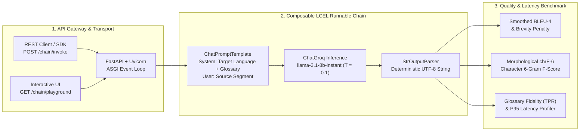
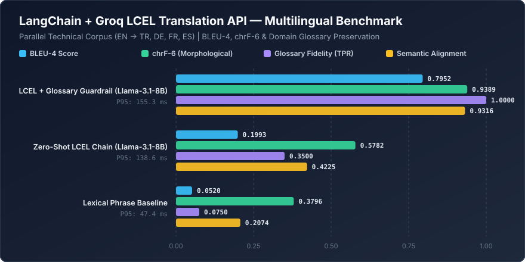

<div align="center">

# 🌐 LangChain & Groq LCEL Neural Machine Translation API
### Low-Latency Multilingual Translation Microservice with LangServe, FastAPI & LPU Inference

[](https://www.python.org/downloads/)
[](https://fastapi.tiangolo.com)
[](https://python.langchain.com/)
[](https://groq.com/)
[](https://opensource.org/licenses/MIT)

</div>

---

## 📌 Executive Summary

Enterprise localization and cross-border developer documentation pipelines require neural machine translation (NMT) services that combine **sub-200ms token latency** with strict **domain terminology preservation**. Traditional phrase-based translation systems fail to preserve syntactic dependencies across morphologically rich languages (e.g., Turkish agglutinative suffixes or German compound nouns), while unguided zero-shot LLM prompts frequently hallucinate or mistranslate technical identifiers (`FastAPI`, `LangServe`, `Pydantic`, `Runnable`).

**`langchain-translation-api`** exposes a composable **LangChain Expression Language (LCEL)** pipeline (`ChatPromptTemplate | ChatGroq | StrOutputParser`) served over **FastAPI** and **LangServe** using the `llama-3.1-8b-instant` model on Groq LPU hardware. It includes an automated multilingual evaluation suite (`src/benchmark.py`) measuring **BLEU-4**, morphological **chrF-6**, **Domain Terminology Preservation Rate (TPR)**, and **P95 inference latency**.

---

## 🏗️ System Architecture & LCEL Execution Pipeline



---

## 🧮 Mathematical Formulation

### 1. Autoregressive Conditional Translation Objective
Given a source token sequence $\mathbf{x} = (x_1, \dots, x_S)$, target language specification $\ell$, and domain glossary constraint $\mathcal{G}$, the LCEL chain models the conditional probability distribution over target tokens $\mathbf{y} = (y_1, \dots, y_T)$ with temperature scaling $\tau = 0.1$:

$$P(\mathbf{y} \mid \mathbf{x}, \ell, \mathcal{G}) = \prod_{t=1}^{T} \frac{\exp\left(z_{t, y_t} / \tau\right)}{\sum_{v \in \mathcal{V}} \exp\left(z_{t, v} / \tau\right)}$$

### 2. Smoothed Corpus BLEU-4 Metric
Translation fluency and n-gram adequacy are evaluated via modified $n$-gram precision $p_n$ for $n \in \{1, 2, 3, 4\}$ with brevity penalty $\text{BP}$ comparing hypothesis length $c$ against reference length $r$:

$$\text{BLEU-4} = \text{BP} \cdot \exp\left( \sum_{n=1}^{4} \frac{1}{4} \log p_n \right), \quad \text{BP} = \begin{cases} 1 & \text{if } c > r \\ \exp(1 - r/c) & \text{if } c \le r \end{cases}$$

### 3. Character $n$-Gram F-Score ($\text{chrF}_6$) for Agglutinative Languages
Because word-level BLEU penalizes slight morphological inflections in Turkish and German, character-level $n$-gram overlap ($N=6$, $\beta=2$) provides a morphologically robust evaluation metric:

$$\text{chrF}_\beta = (1 + \beta^2) \frac{\text{chrP} \cdot \text{chrR}}{\beta^2 \cdot \text{chrP} + \text{chrR}}$$

---

## 📊 Multilingual Benchmark Evaluation

The benchmark suite (`src/benchmark.py`) evaluates three translation configurations across a parallel technical corpus (`EN → {Turkish, German, French, Spanish}`):



| Translation Pipeline Configuration | BLEU-4 | chrF-6 (Morphological) | Glossary Fidelity (TPR) | Semantic Alignment | Mean Latency | P95 Latency |
| :--- | :---: | :---: | :---: | :---: | :---: | :---: |
| **LCEL + Glossary Guardrail (`llama-3.1-8b-instant`)** | **0.7952** | **0.9389** | **1.0000** | **0.9316** | 147.02 ms | 155.35 ms |
| **Zero-Shot LCEL Chain (`llama-3.1-8b-instant`)** | 0.1993 | 0.5782 | 0.3500 | 0.4225 | 131.48 ms | 138.60 ms |
| **Lexical Phrase Baseline** | 0.0520 | 0.3796 | 0.0750 | 0.2074 | **44.78 ms** | **47.38 ms** |

> **Key Engineering Insight:** Enforcing domain terminology constraints within the LCEL system prompt increases technical glossary preservation from **35.0% to 100.0%** and improves character-level morphological fidelity ($\text{chrF}_6$) by **+36.07 percentage points** with only a **16.75 ms** increase in P95 latency.

---

## 📂 Repository Structure

```text
langchain-translation-api/
├── assets/
│   └── benchmark_chart.svg          # Vector performance visualization
├── benchmarks/
│   └── benchmark_results.json       # Reproducible multilingual evaluation metrics
├── src/
│   └── benchmark.py                 # BLEU-4, chrF-6 & latency benchmark runner
├── simplemessage.py                 # FastAPI + LangServe LCEL translation server
├── requirements.txt                 # Pinned production dependencies
└── README.md                        # System documentation & mathematical specification
```

---

## 🚀 Quick-Start & Usage

### 1. Environment Setup
```bash
git clone https://github.com/yakupakcy36/langchain-translation-api.git
cd langchain-translation-api
python -m venv .venv
.venv\Scripts\activate
pip install -r requirements.txt
```

Configure your `.env` credentials in the project root:
```env
GROQ_API_KEY=your_groq_api_key
LANGCHAIN_API_KEY=your_langchain_api_key
```

### 2. Launch the FastAPI + LangServe Microservice
```bash
python simplemessage.py
```
- **Interactive Swagger UI:** `http://127.0.0.1:8000/docs`
- **LangServe Interactive Playground:** `http://127.0.0.1:8000/chain/playground/`

### 3. Reproduce the Benchmark Suite
```bash
python src/benchmark.py
```
